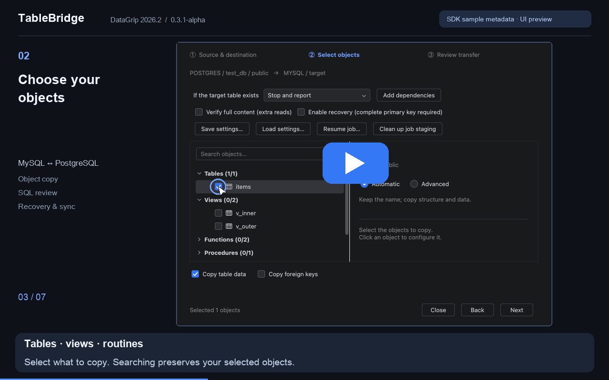
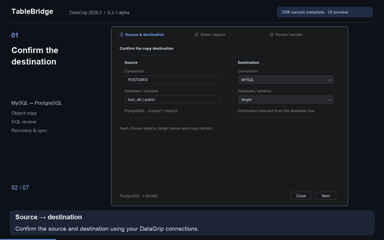
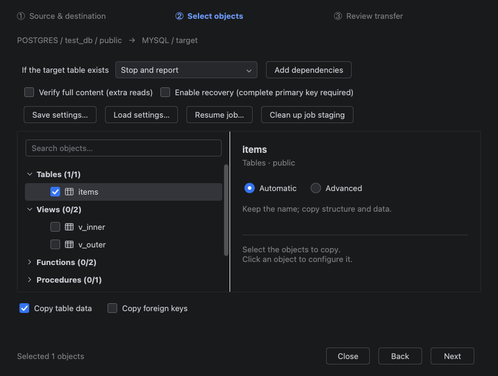
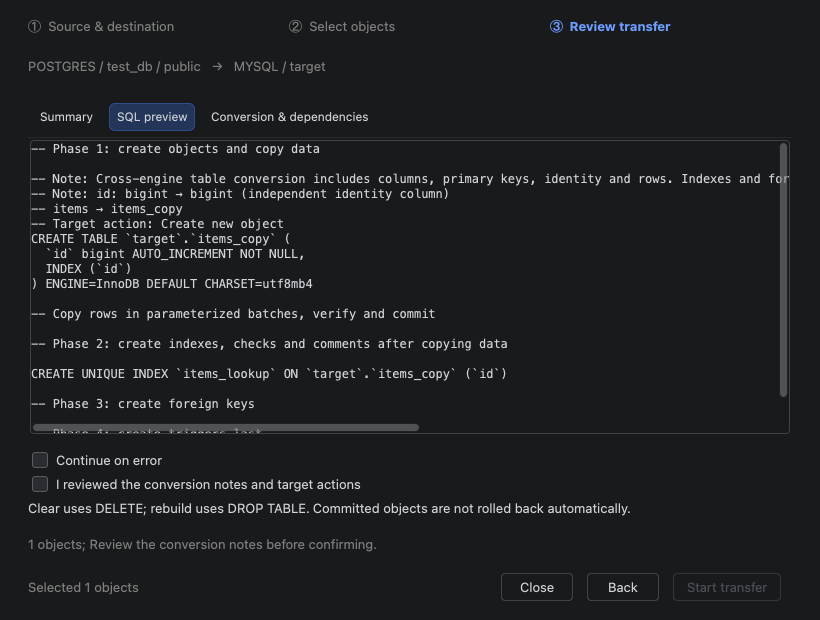

# TableBridge

**Copy database objects between DataGrip connections. Review the SQL, then transfer.**

TableBridge brings a familiar **Copy → Paste** workflow to DataGrip's database tree. Move tables and records between environments, copy supported database objects, or synchronize existing tables by primary key—all from the connections you already use in your IDE.

**DataGrip 2026.2 · MySQL & PostgreSQL · 0.3.4-alpha**

[简体中文](README.zh-CN.md) · [Watch the walkthrough](https://www.youtube.com/watch?v=lTaVCPZRLLQ) · [Detailed support](docs/NON_TABLE_CONVERSION.md)

[](https://www.youtube.com/watch?v=lTaVCPZRLLQ)

*The subtitled walkthrough uses the actual plugin UI captured in an isolated DataGrip SDK environment. It demonstrates configuration and SQL review using sample metadata; it does not execute a database transfer.*

<details>
<summary>Animated preview</summary>



</details>

## Less switching. More control.

- **Copy and paste where you work.** Select objects in the database tree, copy them, and paste onto the destination database or schema. SQL editors and data grids keep their normal copy behavior.
- **Choose what moves.** Copy structure and data, structure only, or records into an existing table. Search objects, rename destinations, and set options per object.
- **Review before writing.** A three-step wizard shows the destination, object summary, generated SQL, type conversions, dependencies, and destructive operations.
- **Keep complex conversions explicit.** Supported cases convert automatically. Advanced editors let you review and supply destination definitions for complex objects, fields, indexes, and triggers.
- **Resume and synchronize.** Optional durable checkpoints support interrupted transfers. Primary-key synchronization can insert/update records or mirror source records by also deleting destination-only keys.
- **Know what happened.** Per-object results show processed rows, time, confirmed commits, and errors. Export the report for review.

## Preview synchronization differences

Insert/update and mirror plans automatically read a preview. Open the **Sync differences** tab to see estimated insert/update/delete/keep counts, primary-key samples and changed fields. Refreshing requires a new execution acknowledgement.

Each table side is limited to 50,000 rows and 32 MiB of normalized content, with at most 20 samples per table. Failed, cancelled or oversized reads display no partial statistics; refresh or explicitly confirm to continue the original sync without preview expiry checks. Recovery keeps the saved staging snapshot and does not create a new preview. Samples remain in dialog memory, outside configurations, recovery manifests and reports.

A successful preview is checked against source and target content before execution, then against the target and staging snapshot before target DML. Changes stop the transfer. Counts use content verification normalization; target collations, conversions, triggers and writes after the final check can affect actual results. Individual large LOB cells are still read in full.

## Get started

Until the plugin is published, install the release ZIP:

1. Open **Settings → Plugins → ⚙ → Install Plugin from Disk…** in DataGrip.
2. Select [`tablebridge-0.3.4-alpha.zip`](dist/tablebridge-0.3.4-alpha.zip).
3. Restart DataGrip.

The current build targets **DataGrip 2026.2 (`262.*`)**. Other IDE versions are not advertised as compatible.

### Copy your first table

1. Connect to the source and destination in DataGrip. Refresh their database metadata.
2. In the **database tree**, select one or more source objects from the same schema.
3. Press **Ctrl+C** on Windows/Linux or **⌘C** on macOS.
4. Select the destination **database/schema node**, then press **Ctrl+V / ⌘V**.
5. Confirm the source and destination. Select objects and configure their options.
6. Review the summary, generated SQL, and conversion notes. Confirm the requested operations, then start.
7. Check the object results and refresh the destination if necessary.

Copying stores object references; table records are transferred only when execution starts. Connections and authentication are managed by DataGrip.



### When the destination table already exists

| Policy | What happens |
|---|---|
| **Stop and report** — default | Refuse to overwrite an existing object. |
| **Append records** | Keep existing records; conflicting primary/unique keys produce an error. |
| **Clear records, then copy** | Delete existing records and copy source data; retain the table structure. |
| **Drop and recreate** | Replace the table structure and copy the selected data. |
| **Incremental insert/update** | Match complete primary keys; insert missing records and update changed records. Keep destination-only records. |
| **Mirror insert/update/delete** | Match primary keys and also delete destination-only records. |

Existing-object policies apply to **tables**. Existing views, routines, sequences, and types are not silently replaced. Delete/recreate and mirror policies require reviewing their effects.

### Need more control?

Select an object and choose **Advanced** to rename it or change its copy options. Table editors expose field mappings and full structure definitions. Non-table editors show source definitions alongside an editable destination definition and explicit dependencies.



### Recover an interrupted transfer

Enable **checkpoints and recovery** before execution. Source and destination tables must have matching complete primary keys; MySQL destinations must use InnoDB.

To continue, choose **Restore task…**, select its saved plan, and use the same source/destination connections and schemas. Confirmed checkpoints are not replayed. Source changes during an incomplete snapshot or an unconfirmed DDL outcome can require manual review rather than an automatic retry.

Checkpoint mode creates task-specific staging and checkpoint tables in the destination schema. It needs create-table permissions and additional space. **Clean current task staging** removes those task-owned tables and the recovery plan while retaining destination objects. See [recovery and synchronization](docs/RECOVERY_SYNC.md).

## What is supported?

| Area | Current scope |
|---|---|
| **Verified databases** | MySQL 8.0.43 and PostgreSQL 18.3 in isolated integration tests, including both conversion directions and DataGrip native driver paths. |
| **Tables and records** | Same-engine copy, MySQL ↔ PostgreSQL conversions, explicit field mappings, and existing-table policies. |
| **Views and routines** | Basic SELECT views and supported scalar expressions convert automatically. Complex views, functions, and procedures require reviewed destination definitions. |
| **Sequences and types** | Supported native objects and bounded conversions where equivalents exist. MySQL has no standalone native sequence or TYPE; unsupported equivalents are reported. |
| **Structure** | Supported keys, indexes, constraints, comments, and native DDL. Collations, advanced indexes, and triggers may require manual destination definitions. New copied triggers are created after data import. |
| **Special values** | Decimal precision, NULLs, binary values, Unicode, supported temporal/JSON mappings, and tested PostgreSQL arrays, composite values, XML, timezone values, and identity records. |
| **Overloads and dependencies** | Signature-aware selection/configuration; reviewed overload aliases, known references, and dependency ordering. Ambiguous calls require manual definitions. |
| **Recovery and sync** | Primary-key checkpoints, bounded transient retries, insert/update, mirror delete, and transaction checks. PostgreSQL deferrable foreign-key cycles can be checked at commit. |
| **Oracle** | Isolated Oracle 19c bidirectional table/type/data helpers have acceptance evidence. Complex objects, full UI and recovery/sync remain experimental. This preview release adds no Oracle database acceptance. |
| **SQL Server** | Outside the supported scope of this release. |

## Important boundaries

This is an **alpha release**. Review conversions and try them with disposable data before using them on important databases.

- There is no promise of automatic equivalence for arbitrary SQL, dynamic routines, collations, or vendor-specific types. Permissions, grants, ownership, and external extensions are not automatically migrated.
- Non-deferrable foreign-key cycles are rejected rather than disabling constraints. Existing destination triggers remain active.
- MySQL/Oracle DDL can commit implicitly. Cancellation or failure may leave created structures, and dropping a table is not a reversible database backup operation.
- Ordinary copy commits per object; checkpoint mode uses its documented staging/transaction strategy. Neither provides a whole-database atomic migration under arbitrary concurrent writes.
- Without a suitable primary key, ordinary copy remains available; automatic checkpoints and synchronization do not.
- Large LOB cells are read as complete values. Content verification and checkpoint snapshots add reads, storage, and execution time.

See [non-table conversion](docs/NON_TABLE_CONVERSION.md), [full structure](docs/FULL_STRUCTURE.md), and [validation evidence](docs/VALIDATION.md) for exact behavior and limitations.

## Privacy and local storage

TableBridge does not add its own password store or cloud transfer service. Database authentication stays with DataGrip. Recovery/configuration files contain selections, SQL definitions, and connection identifiers; primary-key cursors and staged records live in the destination checkpoint tables. Logs can contain object names, definitions, and driver errors—review them before sharing.

## Build and verification

```sh
python3 tools/build.py --test
```

The offline build uses an installed DataGrip 2026.2 SDK/JBR. Release packages contain production classes; SDK fixtures and media tooling are not shipped.

This delivery passed **794 core assertions** and **2,593 real MySQL/PostgreSQL checks**, including difference previews, actual synchronization, session termination, lost commit acknowledgement, and recovery in a separate JVM. Counts describe assertions/checks, not independent test cases. Earlier Oracle evidence is scoped in [Oracle acceptance](docs/ORACLE_ACCEPTANCE.md).

## Feedback

When reporting a problem, include your DataGrip/plugin versions, database versions, source/destination engines, the operation you chose, and a sanitized result report. Remove passwords, connection secrets, and sensitive SQL/data before sharing.

Publishing assets and the Marketplace-ready description are in [docs/MARKETPLACE.md](docs/MARKETPLACE.md). Development history remains in [docs/VALIDATION.md](docs/VALIDATION.md).

License: proprietary, free to use; source code is not distributed. See [EULA](docs/EULA.md).

### Oracle acceptance update

Oracle 19c bidirectional table transfer helpers have now passed isolated MySQL/PostgreSQL tests. See [tested cases and remaining boundaries](docs/ORACLE_ACCEPTANCE.md); this does not certify arbitrary Oracle objects or all UI/recovery paths.
