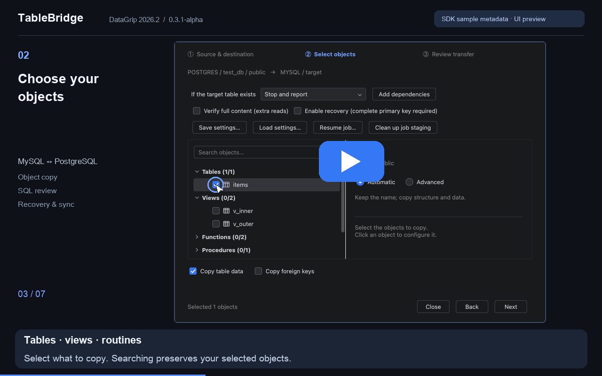
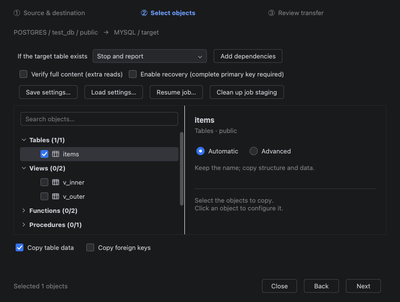
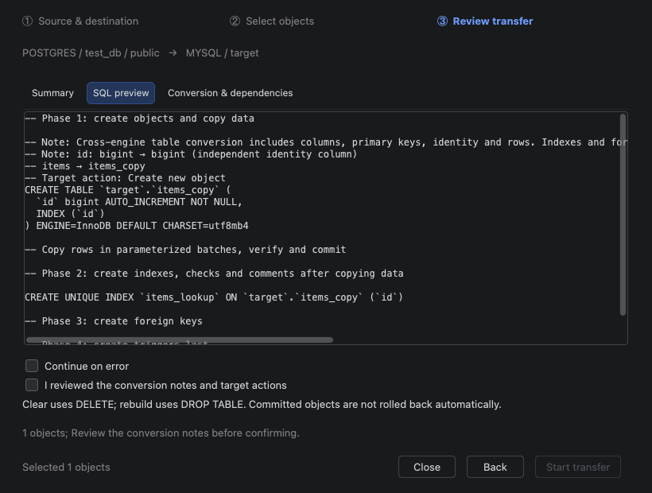

# TableBridge

**在 DataGrip 中复制数据库对象，审核 SQL，然后传输。**

在数据库树中选中对象，**⌘C / Ctrl+C 复制 → 选择目标模式 → ⌘V / Ctrl+V 粘贴**。通过三步向导，在已有连接之间复制表与数据、迁移支持的对象，或按主键同步目标表。

**DataGrip 2026.2 · MySQL / PostgreSQL · 0.3.4-alpha**

[English](README.md) · [观看操作视频](https://www.youtube.com/watch?v=lTaVCPZRLLQ)

视频取自隔离 DataGrip SDK 环境中的真实插件界面，使用示例元数据演示配置和 SQL 审核，不执行数据库传输。含中英文字幕，无需声音即可观看。

## 主要功能

- **熟悉的复制粘贴操作**：在数据库树中使用快捷键。SQL 编辑器、数据网格继续保持原来的复制行为。
- **决定复制范围**：表结构和数据、仅结构，或向已有表复制记录；支持搜索、多选、目标改名和单对象设置。
- **执行前看清操作**：三步向导展示目标位置、对象摘要、生成 SQL、字段映射、依赖和可能删除数据的操作。
- **复杂定义可编辑**：可以自动等价转换的情况自动处理；复杂视图、函数、过程、排序规则、索引和触发器提供目标定义审核入口。
- **断点与主键同步**：持久检查点、有限自动重试、按主键新增/更新，以及包含删除的镜像同步。
- **同步差异预览**：确认页显示预计新增、更新、删除和保留数量，提供字段变化样例与刷新；成功预览后，执行前复查数据是否变化。
- **结果可追溯**：查看每个对象的状态、行数、耗时、提交确认和错误，并导出报告。

## 安装

尚未发布到商店时，可通过离线包安装：

1. 打开 DataGrip **设置 → 插件 → ⚙ → 从磁盘安装插件**。
2. 选择 [`tablebridge-0.3.4-alpha.zip`](dist/tablebridge-0.3.4-alpha.zip)。
3. 重启 DataGrip。

当前支持 **DataGrip 2026.2（262.*）**，不承诺其他版本兼容。

## 第一次复制

1. 在 DataGrip 连接来源和目标，刷新数据库元数据。
2. 在**数据库树**选中同一模式下的一个或多个对象。
3. 使用 **⌘C（macOS）/ Ctrl+C（Windows、Linux）**。
4. 选中目标**数据库或 schema 节点**，使用 **⌘V / Ctrl+V**。
5. 确认来源和目标，选择对象，在“自动 / 高级”中配置。
6. 审核摘要、生成 SQL、类型变化和依赖说明，确认后开始。
7. 查看执行结果；目标刷新失败时手工刷新。

复制时保存的是对象引用；点击执行后才读取和写入表记录。连接认证由 DataGrip 管理。

## 目标表已经存在怎么办？

| 策略 | 行为 |
|---|---|
| **停止并提示（默认）** | 拒绝覆盖已有对象。 |
| **追加数据** | 保留已有记录；主键或唯一键冲突时报告错误。 |
| **清空后复制** | 删除已有记录，保留表结构，再复制来源数据。 |
| **删除并重建** | 删除目标表，重新建立结构并复制选中的数据。 |
| **增量：新增 / 更新** | 按完整主键插入缺失记录、更新变化记录，保留目标独有记录。 |
| **镜像：新增 / 更新 / 删除** | 按主键同步，并删除目标中来源不存在的记录。 |

已有对象处理只适用于**表**；视图、函数等不会被静默替换。删除、重建和镜像策略需要认真核对执行影响。

## 高级配置

点击对象名称，选择“高级”以改名或调整复制内容。表对象可编辑字段映射和完整结构；非表对象可并排查看来源定义、编辑目标定义并指定依赖。

## 查看同步差异

选择“增量”或“镜像”策略后，确认页自动读取差异；打开“同步差异”页签查看数量、主键样例和变化字段。点击“刷新差异预览”重新读取后，需要重新勾选执行确认。

第一版每表每侧最多读取 50,000 行、累计最多 32 MiB 归一化内容，最多展示 20 条样例。超限、失败或取消不会提供部分统计，可刷新或明确确认后继续原有同步；无成功预览时不启用预览过期检查。恢复任务沿用已有暂存快照，不生成新的预览。样例只留在本次界面内存，不写入配置、恢复计划或结果报告。

成功预览后，执行前核对来源与目标内容摘要，暂存完成后再次核对目标与暂存快照；变化时停止并要求重新生成计划。数量采用内容校验的归一化比较规则估算，目标排序规则、转换及触发器可能导致实际数量不同；复查后发生的并发写入不属于锁定保护范围。大 LOB 单元格仍整体读取。详见 [恢复与同步说明](docs/RECOVERY_SYNC.md)。

## 中断后继续

执行前勾选“启用断点与恢复”。要求来源与目标有相同的完整主键；MySQL 目标需要使用 InnoDB。

点击“恢复任务…”，选择保存的计划，使用相同来源/目标连接与模式。已确认检查点不重复执行；来源快照发生变化或 DDL 提交结果不明时，可能需要人工审核。

断点模式会在目标模式创建任务专属暂存表和检查点表，需要建表权限与额外空间。“清理当前任务暂存”删除任务内部表和恢复计划，保留目标对象。详见[恢复与同步说明](docs/RECOVERY_SYNC.md)。

## 支持范围

- **实际验收**：MySQL 8.0.43、PostgreSQL 18.3；覆盖同类型复制、两种数据库之间转换和 DataGrip 原生驱动。
- **数据库对象**：表、视图、函数、过程、序列和类型；以数据库实际能力与已加载元数据为准。MySQL 没有原生独立序列/TYPE，不会偷偷仿真。
- **表结构**：支持范围内的键、索引、约束、注释和原生 DDL；复杂排序规则、高级索引和触发器需要目标定义审核，新复制触发器在数据导入后创建。
- **特殊值**：精确数值、NULL、二进制、Unicode、支持的时间/JSON 映射，以及已验证的 PostgreSQL 数组、复合类型、XML、时区值和 identity 记录。
- **重载与依赖**：按参数签名识别；支持审核后的独立目标名、已知引用和依赖排序。歧义调用需要手工定义；PostgreSQL 可延迟循环外键可在提交时校验。
- **Oracle**：19c 表/类型/数据传输辅助路径已有隔离双向验收；复杂对象、完整 UI 与恢复/同步仍属实验性。本次差异预览没有新增 Oracle 实库验收。
- **SQL Server**：不在当前版本的支持范围。

## 使用边界

当前是 **alpha 版本**。请先用可丢弃数据验证，再操作重要数据库。

- 不承诺任意程序、动态 SQL、排序规则或厂商类型自动等价；权限、GRANT、所有者和外部扩展不会自动迁移。
- 非延迟循环外键在写入前拒绝；不会关闭约束。已有目标触发器仍可能执行。
- MySQL / Oracle DDL 可能隐式提交；失败或取消后可能保留已建结构。恢复计划不能还原已经 DROP 的旧表。
- 普通复制按对象提交；断点模式使用暂存与事务检查点，不等于任意并发写入下的整库原子迁移。
- 无适合主键的表可普通复制，不能自动断点或同步。大 LOB 单元格整体读取；全量校验和断点模式增加读取、存储和耗时。

准确覆盖范围见[非表对象转换](docs/NON_TABLE_CONVERSION.md)、[完整结构](docs/FULL_STRUCTURE.md)和[验收记录](docs/VALIDATION.md)。

## 隐私与验证

插件不新增密码存储或云传输服务，认证交给 DataGrip。配置和恢复计划包含选择、SQL 定义及连接标识；主键游标和暂存数据保存在目标检查点表。日志可能包含对象名、定义和驱动错误，分享前请脱敏。

本次交付通过 **794 项核心断言、2,593 项 MySQL / PostgreSQL 实库检查**，包括差异预览、实际同步、断线恢复和独立 JVM 恢复。数字是检查数量，不是独立测试用例数；此前 Oracle 验收范围见 [Oracle 验收记录](docs/ORACLE_ACCEPTANCE.md)。

开发构建：`python3 tools/build.py --test`，使用本机 DataGrip 2026.2 SDK/JBR。发行包不包含测试夹具和演示工具。

反馈时请提供 IDE/插件/数据库版本、来源与目标类型、操作策略和脱敏结果报告。商店介绍、视频和截图发布说明见[发布材料](docs/MARKETPLACE.md)。

许可证：闭源、免费使用；源码不公开。详见 [使用许可](docs/EULA.md)。
