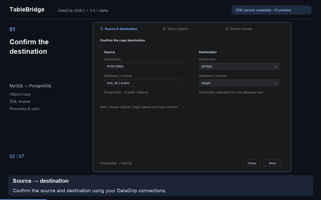
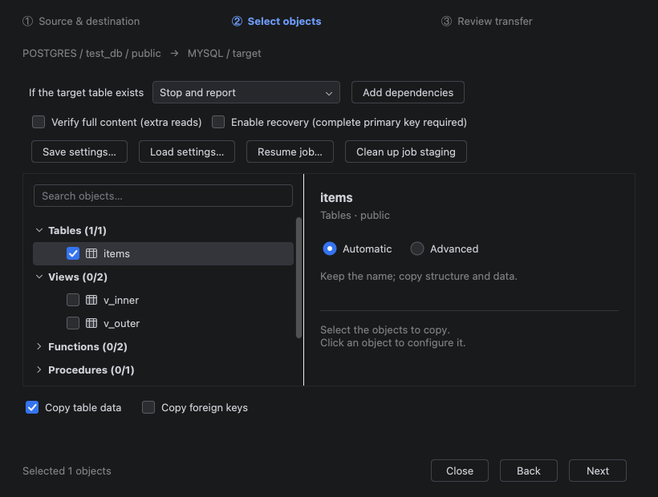
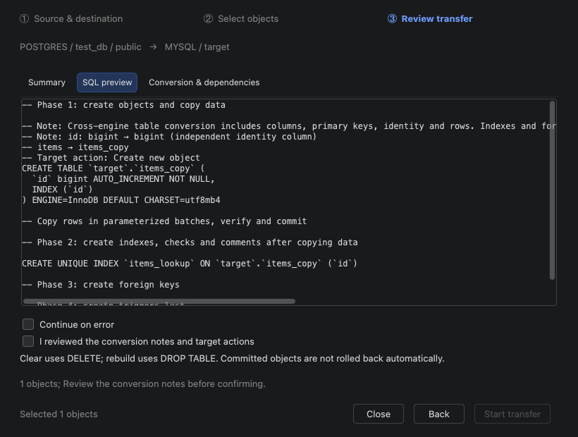

# 我给 DataGrip 写了个插件：复制粘贴就能跨库复制表

把开发库里的几张表复制到测试库，是一个很具体的需求：有时需要结构和数据一起复制，有时只要表结构，有时目标表已经存在，需要决定怎样处理已有记录。

如果来源和目标都已经连接在 DataGrip 里，我希望能直接在数据库树中完成这件事。因此，我做了一个插件 **TableBridge**：选中来源对象，复制，选中目标数据库或 schema，粘贴，再通过向导配置和审核传输。

它的操作入口很熟悉，但粘贴后不会立即写数据库。你可以先确认目标位置、复制范围和生成的 SQL，再开始执行。

如果你平时使用 Navicat 处理数据库复制，也可以了解一下这个面向 DataGrip 用户的方案：当来源和目标连接已经配置在 DataGrip 中，TableBridge 让你通过数据库树的复制粘贴进入跨连接传输向导，并在执行前审核 SQL。插件安装在 DataGrip 中。

## 先看操作方式

以把 MySQL 开发库的一张表复制到另一个 MySQL 测试库为例，操作顺序是：

1. 在 DataGrip 中连接来源和目标，刷新数据库元数据。
2. 在数据库树中选中来源表，按 **Ctrl+C**；macOS 使用 **⌘C**。
3. 选中目标数据库或 schema 节点，按 **Ctrl+V / ⌘V**。
4. 在向导中确认来源和目标，选择要复制的对象。
5. 配置复制范围，审核摘要和生成的 SQL，然后开始。
6. 查看每个对象的执行结果，并刷新目标。

这里的复制粘贴发生在**数据库树**中。SQL 编辑器和数据网格仍保持原来的复制行为。复制时保存的是对象引用，执行后才读取和写入表记录。

上述步骤是操作说明；本文截图和现有视频展示配置与 SQL 审核，不包含这次示例的真实传输结果。

## 决定复制什么

TableBridge 支持复制表结构和数据、仅复制结构，以及向已有表复制记录。选择多个对象时，可以搜索、筛选，并为单个对象配置目标名称和复制内容。

目标表已经存在时，默认策略是停止并提示。其他策略包括追加数据、清空后复制、删除并重建，以及按主键新增和更新。

这里尤其需要区分两种同步方式：

- **增量新增 / 更新**：插入缺失记录，更新变化记录，保留目标独有记录。
- **镜像新增 / 更新 / 删除**：还会删除目标中来源不存在的记录。

它们会产生不同的数据影响。选择前应确认自己希望保留哪些数据，并核对执行摘要。

## 执行前审核 SQL

这是我希望保留在流程里的一个关键环节：在写入目标之前，看到插件准备做什么。

向导展示目标位置、对象摘要、生成 SQL、类型转换和依赖说明。表对象可以调整字段映射和结构定义；非表对象可以并排查看来源定义与目标定义。

对于 MySQL 与 PostgreSQL 之间支持的转换，插件会处理能够自动转换的情况。复杂视图、函数、过程、排序规则、高级索引和触发器，可能需要审核或手工编辑目标定义。我没有把任意 SQL 的自动等价转换作为产品承诺。

## 连接、恢复和结果

数据库连接与认证由 DataGrip 管理。插件不新增自己的密码存储或云传输服务。

执行结果会按对象展示状态、处理行数、耗时、提交确认和错误，并支持导出报告。

对于需要中断恢复的任务，可以提前启用检查点。这个模式有前提：来源和目标需要有相同的完整主键，MySQL 目标需要使用 InnoDB；目标模式还需要建表权限与额外空间，用于任务暂存表和检查点表。

恢复和主键同步更适合单独展开介绍。第一次试用，建议先完成一张小表的普通复制，确认流程符合自己的需求。

## 当前适用范围

当前插件是 **alpha 版本**，兼容范围为 **DataGrip 2026.2（262.*）**。

已经有实库验收记录的数据库是 MySQL 8.0.43 和 PostgreSQL 18.3，覆盖同类型复制和两者之间的转换。支持范围内的对象包括表、视图、函数、过程、序列和类型，具体能力取决于数据库和对象定义。

Oracle 实现仍属实验性，未通过本版本的实库验收；SQL Server 不在当前支持范围。权限、GRANT、所有者和外部扩展不会自动迁移。

先使用可丢弃的数据试用。删除重建和镜像同步会影响目标数据，部分数据库的 DDL 还可能隐式提交，失败后可能保留已创建的结构。TableBridge 不能替代数据库备份。

## 安装和反馈

TableBridge **免费使用，源码未公开**。

- [JetBrains Marketplace 插件页面](https://plugins.jetbrains.com/plugin/34687-tablebridge--database-object-copy)
- [56 秒界面操作演示](https://www.youtube.com/watch?v=lTaVCPZRLLQ)
- [使用许可](https://gist.github.com/fenghlkevin/7758c08f1d9eb3733a11b8e9f8c9cefd)

插件已在 JetBrains Marketplace 上架。在 DataGrip 的“设置 → 插件 → Marketplace”中搜索 **TableBridge**，确认兼容性后安装并重启，也可以从上面的商店页面进入安装。具体版本以商店页面为准。现有视频使用真实插件界面与示例元数据，演示对象选择、配置和 SQL 审核，不执行数据库传输。

如果你也有在 DataGrip 中跨连接复制表的需求，欢迎试用，并在评论中告诉我：来源和目标是什么数据库、需要复制结构还是数据、哪个环节最不顺手。

报告问题时，请附 IDE、插件和数据库版本，以及脱敏后的操作步骤和结果。请去掉连接凭据、敏感 SQL 和业务数据。
