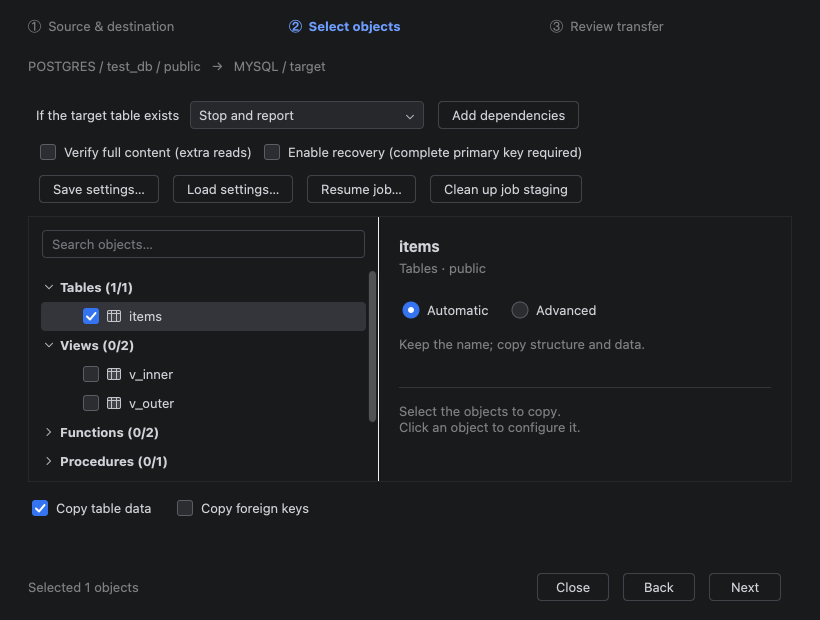

# 做了一个 DataGrip 插件：在数据库树里复制粘贴，跨连接复制表

大家好，我做了一个 DataGrip 插件 **TableBridge**，希望把“从开发库复制几张表到测试库”这类操作放到 IDE 里完成。

操作入口是数据库树里的复制粘贴：

选中来源表 → Ctrl+C / ⌘C → 选中目标 schema → Ctrl+V / ⌘V → 配置复制范围 → 审核 SQL → 开始传输。

粘贴后先打开向导，不会立即写库。可以复制结构和数据、仅结构，或向已有表复制记录；也支持目标改名、字段映射和按主键新增 / 更新。

我比较关注执行前的可见性：目标位置、已有表处理策略、生成 SQL 和转换说明都放在审核流程里。连接认证继续由 DataGrip 管理，插件不新增自己的密码存储或云传输服务。

目前免费使用、源码未公开，属于 alpha 阶段，只支持 DataGrip 2026.2（262.*）。MySQL / PostgreSQL 有实库验收记录，跨数据库的复杂定义可能需要手工审核；Oracle 是未实库验收的实验实现，SQL Server 暂不支持。

- 插件页面：https://plugins.jetbrains.com/plugin/34687-tablebridge--database-object-copy
- 界面演示：https://www.youtube.com/watch?v=lTaVCPZRLLQ

插件已在 JetBrains Marketplace 上架，可以在 DataGrip 的插件 Marketplace 中搜索 **TableBridge**，确认兼容性后安装并重启。具体版本以商店页面为准。

演示视频展示真实插件界面中的配置与 SQL 审核，使用示例元数据，没有实际执行传输。试用请先用可丢弃数据。

想找一些有类似需求的朋友试用，也想听听大家现在如何处理这类操作：你最常用的是同类型数据库复制，还是 MySQL / PostgreSQL 之间转换？目标表已经存在时，你更需要追加还是按主键更新？

如果遇到问题，欢迎在帖子中提供版本和脱敏步骤，请不要贴连接凭据和业务数据。
